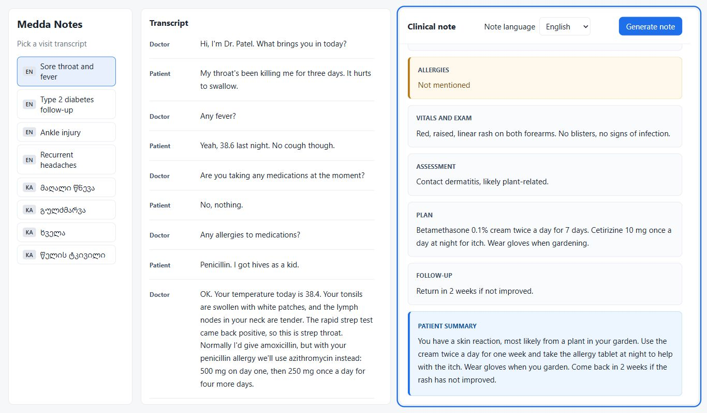
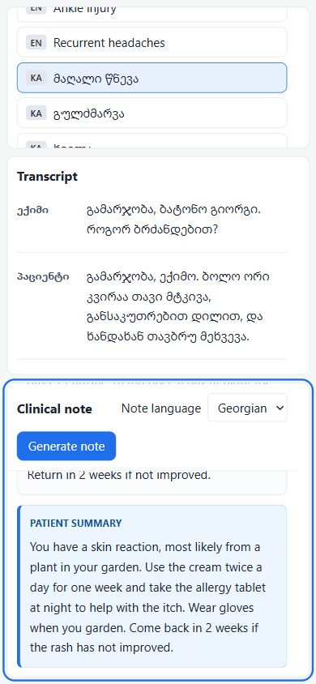

# Submission

**Name:**
**Level applied for:** Junior / Middle
**Time spent:** about **\_ hours
**LLM used:** Gemini (model: \_**)

## Part 1: Frontend bugs

| #   | Problem                                          | Cause                                    | Fix                                                             |
| --- | ------------------------------------------------ | ---------------------------------------- | --------------------------------------------------------------- |
| 1   | Transcripts kept fetching.                       | `useEffect` had no dependency array.     | Added `[]` and cleanup.                                         |
| 2   | Generation errors showed an empty result.        | The response status wasn't checked.      | Check `res.ok` and show the error.                              |
| 3   | The button stayed on “Generating…”.              | Loading reset only on success.           | Reset it in `finally`.                                          |
| 4   | Language badges were reversed.                   | EN and KA labels were swapped.           | Corrected the labels.                                           |
| 5   | Loading transcripts had no feedback.             | No loading or error states.              | Added loading, error, and empty states.                         |
| 6   | An old note could appear after switching visits. | Earlier requests still updated the page. | Ignore outdated responses when the visit or language changes.   |
| 7   | The conversation was hard to read.               | Line breaks were collapsed.              | Separate speaker labels from dialogue and preserve line breaks. |

## Part 2: Backend bugs

| #   | Problem                                      | Cause                                                           | Fix                                                                 |
| --- | -------------------------------------------- | --------------------------------------------------------------- | ------------------------------------------------------------------- |
| 1   | Georgian text was unreadable.                | Files were read as Latin-1.                                     | Changed the encoding to UTF-8.                                      |
| 2   | Generate note couldn't find the visit.       | The frontend sent `transcriptId`; the API read `transcript_id`. | Use `transcriptId` on both sides.                                   |
| 3   | Invalid IDs caused unclear errors.           | Missing input and lookup checks.                                | Return `400` for invalid IDs and `404` for unknown visits.          |
| 4   | Every provider returned the mock note.       | Provider selection used `=` instead of `===`.                   | Fixed the comparison.                                               |
| 5   | Generation failures returned success status. | The error response used the default `200`.                      | Return `500` with a friendly message and log details on the server. |

I also added a native Gemini provider. Malformed JSON handling is still pending.

## Part 3: Note language selector

The selector offers English and Georgian and defaults to the selected visit's language. The UI sends the choice to the API, which accepts only `en` or `ka`. The prompt uses that language for the note, headings, and missing-information phrases.

I tested `ka-01` in English and Georgian, and `en-01` in Georgian with Gemini. The language and headings were correct. Changing the language clears the previous note.

## Part 4: Note generation and prompt

I kept one model call to keep things simple. The prompt follows `NOTE_SPEC.md`: use only transcript facts, separate current and new medications, leave out rejected treatments, and use the required sections and formatting. The patient summary should address “you” in 3–5 short sentences.

The first results added an unstated diagnosis, used third person, and missed follow-up details. I added clearer rules and tested again. The new `ka-01` English result used `Not mentioned` for the assessment and included follow-up and warning signs. The new `en-01` Georgian result improved number formatting and the patient summary.

Some details still need work: the Georgian translation broadened “hives” to “rash” and “pain when swallowing” to “difficulty swallowing.” The English summary omitted the blood tests, and the plan omitted the same-time medication instruction. Full evaluation is still pending. The original prompt is saved for comparison.

## Part 5: Note view design

I used plain CSS with clear sections, a separate blue patient summary, and amber highlights for missing information. The copy button copies the original plain text. If the section format isn't recognized, the full note is shown.

The page uses `100dvh` with 3 independently scrolling panels. The clinical-note header stays visible while scrolling. The conversation uses speaker labels and dividers, and the layout supports Georgian and smaller screens.

TypeScript, the production build, and local behavior checks passed. Desktop and mobile layouts were checked in the browser.

Screenshots use local mock responses; the sample note is unrelated to the selected visit.

## Part 6: Evals

| Prompt   | Checks passed | Pass rate |
| -------- | ------------- | --------- |
| Original |               |           |
| Mine     |               |           |

How you chose the expectations for en-02, en-03, ka-01, ka-03:

Weaknesses of these evals (what could pass the checks but still be a bad note?):

## Middle-level extras (if applicable)

Your extra check(s) and why:

Cross-language evals (`--lang`):

Stability across 3 runs:

How you would add a review/verification step:

## Use of AI tools

I used Codex to understand the starter project, implement fixes and features, refactor the code, and run local checks. I tested Gemini outputs manually and used those results to improve the prompt. Codex also helped edit this submission.

## What you would do with more time

Improve translation precision, test more visits, and add an independent check for unsupported facts and missing instructions.
